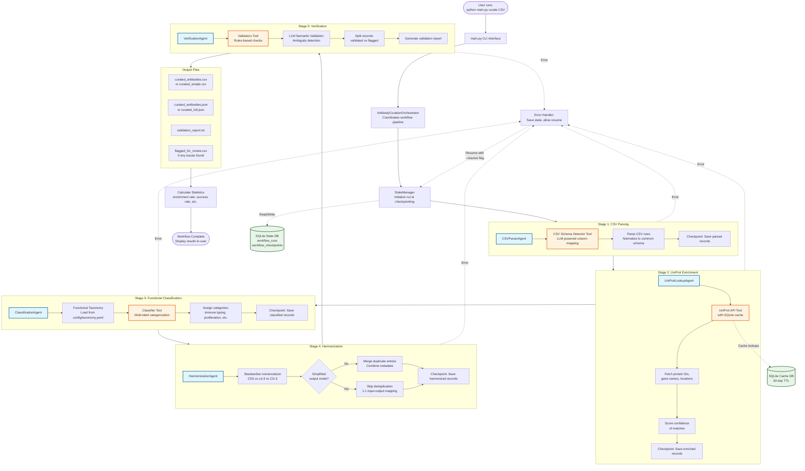

# Antibody Curation Agent System

An intelligent agentic system for curating and harmonizing antibody metadata from multiplexed tissue imaging experiments. Built using the Claude Agent SDK principles with a multi-agent orchestration architecture.

## System Architecture & Workflow



### Key Components

**Orchestrator Layer:**
- **AntibodyCurationOrchestrator** - Main coordinator managing workflow pipeline
- **StateManager** - SQLite-based checkpointing and resume capability

**Agent Layer (Specialized Agents):**
- **CSVParserAgent** - Handles varied CSV structures with LLM-powered schema detection
- **UniProtLookupAgent** - Enriches with protein database information
- **ClassificationAgent** - Assigns functional categories using taxonomy
- **HarmonizationAgent** - Deduplicates and standardizes nomenclature
- **VerificationAgent** - Validates quality with rules + LLM checks

**Tool Layer (Reusable Utilities):**
- **csv_analyzer.py** - LLM-powered CSV column mapping
- **uniprot_api.py** - REST API client with caching
- **classifier.py** - Multi-label functional classifier
- **validators.py** - Rules-based + semantic validation

### Feedback Loop Pattern

Each agent follows the Claude Agent SDK feedback loop:
1. **Gather Context** - Load data and configuration
2. **Take Action** - Execute specialized task (parse, enrich, classify, etc.)
3. **Verify Work** - Check results, handle errors
4. **Checkpoint** - Save state for resumability
5. **Repeat** - Continue to next stage

## Overview

This system automates the curation of antibody panels by:
- **Parsing varied CSV structures** using LLM-powered schema detection
- **Enriching** with UniProt protein information
- **Classifying** markers into functional categories (immune typing, proliferation, signaling, etc.)
- **Harmonizing** duplicate entries and standardizing nomenclature
- **Validating** data quality with rules-based and semantic checks

## Architecture

The system follows the Claude Agent SDK feedback loop pattern: **gather context → take action → verify work → repeat**.

### Components

```
orchestrator.py          # Main controller coordinating workflow
├── agents/
│   ├── csv_parser_agent.py         # Parses varied CSV structures
│   ├── uniprot_agent.py             # Enriches with UniProt data
│   ├── classification_agent.py     # Assigns functional categories
│   ├── harmonization_agent.py      # Deduplicates and standardizes
│   └── verification_agent.py       # Validates quality
└── tools/
    ├── uniprot_api.py              # UniProt REST API with caching
    ├── csv_analyzer.py             # LLM-powered CSV schema detection
    ├── classifier.py               # Multi-label functional classifier
    └── validators.py               # Rules-based + LLM validation
```

### Workflow Pipeline

```
1. Ingest      → CSV Parser Agent discovers column structure
2. Extract     → Parse all files, normalize to common schema
3. Enrich      → UniProt Lookup Agent fetches protein IDs
4. Classify    → Functional Classification Agent assigns categories
5. Harmonize   → Resolve conflicts, standardize terms
6. Verify      → Validation checks, flag issues
7. Export      → Curated CSV + validation report
```

## Installation

### Requirements

- Python 3.9+
- Anthropic API key

### Setup

```bash
# Clone or create project directory
cd ch_metadata_agent

# Create virtual environment
python -m venv venv
source venv/bin/activate  # On Windows: venv\Scripts\activate

# Install dependencies
pip install -r requirements.txt

# Set API key
export ANTHROPIC_API_KEY='your-api-key-here'
# Or create .env file:
echo "ANTHROPIC_API_KEY=your-api-key-here" > .env
```

## Usage

### Quick Start

```bash
# Curate antibody CSV file
python main.py curate path/to/antibodies.csv

# Output will be saved to data/output/<run_id>/
```

### Commands

#### 1. Curate Antibody CSV

Run the full curation workflow on an antibody panel CSV:

```bash
python main.py curate antibodies.csv \
  --api-key YOUR_API_KEY \
  --output-dir ./results \
  --config config/taxonomy.yaml
```

**Options:**
- `--api-key`: Anthropic API key (or set `ANTHROPIC_API_KEY` env var)
- `--output-dir`: Output directory (default: `data/output`)
- `--cache-dir`: Cache directory for UniProt lookups (default: `data/cache`)
- `--config`: Path to taxonomy config (default: `config/taxonomy.yaml`)
- `--run-id`: Custom run ID (auto-generated if not specified)
- `--resume`: Resume from checkpoint if workflow was interrupted

**Output Files:**
- `curated_antibodies.csv` - Validated antibody records
- `curated_antibodies.json` - JSON format
- `validation_report.txt` - Quality validation report
- `flagged_for_review.csv` - Records requiring manual review (if any)

#### 2. Analyze CSV Structure

Preview how the system will interpret your CSV without running the full workflow:

```bash
python main.py analyze antibodies.csv
```

Shows:
- Detected column mappings
- Sample data preview
- Missing fields

#### 3. Lookup Protein in UniProt

Quick protein lookup:

```bash
python main.py lookup CD3
python main.py lookup Ki67 --organism human
```

#### 4. List Functional Categories

View available classification categories:

```bash
python main.py categories
```

## Input CSV Format

The system handles **varied column naming conventions**. It will automatically detect columns like:

### Example CSV Structures

**Example 1: Standard format**
```csv
Marker,Target,Clone,Vendor,Fluorophore
CD3,CD3E,UCHT1,BioLegend,Alexa488
Ki67,MKI67,Ki-67,Abcam,PE
```

**Example 2: Alternative naming**
```csv
Antibody Name,Gene Name,Catalog #,Company,Conjugate
pan-Cytokeratin,KRT18,ab52948,Abcam,FITC
CD68,CD68,Y1/82A,eBioscience,APC
```

The CSV Parser Agent uses Claude to intelligently map columns regardless of naming variations.

## Functional Categories

Markers are classified into these categories:

- **Immune Cell Typing** - CD3, CD20, CD68, etc.
- **Lymphocyte Profiling** - CD4, CD8, FOXP3, etc.
- **Myeloid Profiling** - CD68, CD163, CD11c, etc.
- **Immune Activation** - HLA-DR, PD-1, PD-L1, etc.
- **Proliferation** - Ki67, PCNA
- **Tissue Architecture** - SMA, Vimentin, Collagen
- **Hypoxia** - CA9, HIF1a
- **Tumor-Specific** - HER2, EGFR, PSA
- **Signaling** - pERK, pAKT, pSTAT3
- **Cell Metabolism** - GLUT1, CPT1A
- **Segmentation** - Pan-CK, DAPI, Beta-catenin

Categories are defined in `config/taxonomy.yaml` and can be customized.

## State Management & Checkpointing

The system implements robust state management with SQLite:

- **Automatic checkpointing** after each workflow stage
- **Resume from failures** using `--resume` flag
- **Audit trail** of all processing decisions
- **Cache layer** for UniProt responses (30-day TTL)

## Error Handling

The system implements multiple error handling strategies:

1. **UniProt API failures** - Exponential backoff, cached fallback
2. **Ambiguous mappings** - Confidence scoring, flag for review
3. **Missing data** - Partial annotation with warnings
4. **Schema detection failures** - Fallback to manual column specification

## Advanced Usage

### Custom Taxonomy

Create a custom taxonomy configuration:

```yaml
# my_taxonomy.yaml
categories:
  custom_category:
    name: "My Custom Category"
    description: "Description of what this category means"
    keywords:
      - keyword1
      - keyword2
    examples:
      - "Example marker 1"
      - "Example marker 2"
```

Use with:
```bash
python main.py curate antibodies.csv --config my_taxonomy.yaml
```

### Programmatic Usage

```python
from pathlib import Path
from orchestrator import AntibodyCurationOrchestrator

# Initialize orchestrator
orchestrator = AntibodyCurationOrchestrator(
    api_key='your-api-key',
    cache_dir=Path('data/cache'),
    output_dir=Path('data/output')
)

# Run workflow
result = orchestrator.curate_antibody_csv(
    csv_file=Path('antibodies.csv')
)

# Access results
print(f"Status: {result.status}")
print(f"Curated: {len(result.curated_records)} records")
print(f"Flagged: {len(result.flagged_records)} records")
print(result.validation_report)
```

### Using Individual Agents

You can also use agents independently:

```python
from agents.csv_parser_agent import CSVParserAgent
from agents.uniprot_agent import UniProtLookupAgent

# Parse CSV
parser = CSVParserAgent(api_key='your-key')
result = parser.execute('antibodies.csv')
records = result.data['records']

# Enrich with UniProt
enricher = UniProtLookupAgent()
result = enricher.execute(records)
enriched_records = result.data['records']
```

## Development

### Project Structure

```
ch_metadata_agent/
├── agents/              # Agent implementations
├── tools/               # Core utility tools
├── config/              # Configuration files
├── data/
│   ├── cache/          # UniProt cache (SQLite)
│   ├── state/          # Workflow state (SQLite)
│   └── output/         # Results
├── main.py             # CLI interface
├── orchestrator.py     # Main orchestrator
└── requirements.txt    # Dependencies
```

### Running Tests

```bash
# Create a test CSV
echo "Marker,Target,Clone
CD3,CD3E,UCHT1
Ki67,MKI67,Ki-67" > test_antibodies.csv

# Run curation
python main.py curate test_antibodies.csv
```

## Design Principles

This system follows the [Claude Agent SDK](https://www.anthropic.com/engineering/building-agents-with-the-claude-agent-sdk) best practices:

1. **Feedback Loop Pattern** - Each agent implements: gather context → take action → verify work
2. **Specialized Agents** - Single-responsibility agents for parsing, enrichment, classification, etc.
3. **State Management** - Persistent state with checkpointing for long-running workflows
4. **Error Recovery** - Retry logic, graceful degradation, human-in-the-loop for ambiguous cases
5. **Tool Composition** - Reusable tools (UniProt API, CSV analyzer, validators) shared across agents

## Troubleshooting

### Common Issues

**Issue:** Low enrichment rate from UniProt
- **Solution:** Check that marker names use standard nomenclature (e.g., "CD3" not "cd-3")

**Issue:** CSV parsing fails
- **Solution:** Ensure CSV is UTF-8 encoded and properly formatted

**Issue:** API rate limits
- **Solution:** UniProt cache reduces API calls; adjust batch delay in `tools/uniprot_api.py`

## Contributing

To extend the system:

1. **Add new categories** - Edit `config/taxonomy.yaml`
2. **Create custom agents** - Extend `agents/base_agent.py`
3. **Add tools** - Create new tools in `tools/` directory
4. **Modify workflow** - Edit `orchestrator.py` pipeline

## License

MIT License - see LICENSE file for details

## Citation

If you use this system in your research, please cite:

```
@software{antibody_curation_agent,
  title = {Antibody Curation Agent System},
  author = {Your Name},
  year = {2024},
  url = {https://github.com/yourusername/ch_metadata_agent}
}
```

## Support

For issues or questions:
- Open an issue on GitHub
- Email: your.email@example.com

## Acknowledgments

- Built with [Anthropic Claude](https://www.anthropic.com/)
- UniProt REST API for protein data
- Inspired by [Claude Agent SDK](https://www.anthropic.com/engineering/building-agents-with-the-claude-agent-sdk)
