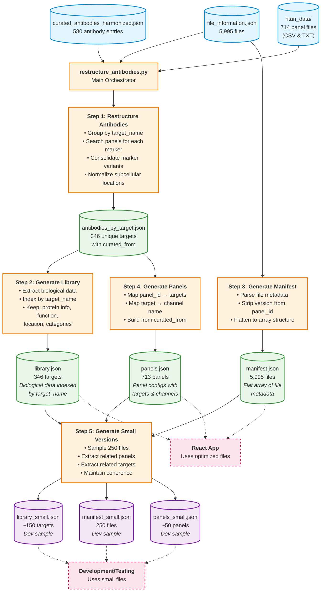
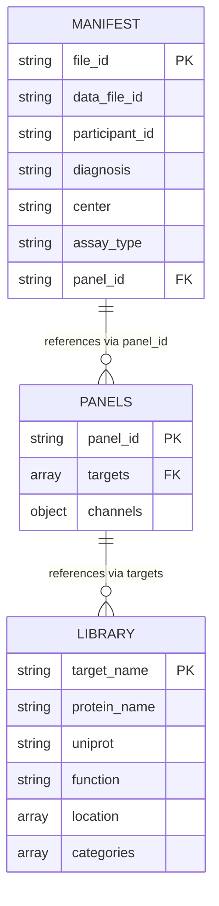

# Data Processing Workflow

## Overview
This workflow diagram shows how `restructure_antibodies.py` transforms raw antibody and file metadata into optimized files for the React app.

## Workflow Diagram



## Process Details

### Step 1: Restructure Antibodies
**Function:** `restructure_antibodies()`
- **Input:** curated_antibodies_harmonized.json + htan_data/
- **Process:**
  1. Read 580 antibody entries
  2. Group by `target_name` (consolidates marker variants)
  3. Search each marker in htan_data files (regex search)
  4. Build `curated_from` mapping (panel → marker)
  5. Normalize subcellular locations to 3 categories
- **Output:** antibodies_by_target.json (346 unique targets)

### Step 2: Generate Library
**Function:** `generate_library()`
- **Input:** antibodies_by_target.json
- **Process:**
  1. Extract biological fields only
  2. Create object indexed by target_name
  3. Drop panels_seen_in, curated_from
- **Output:** library.json (biological encyclopedia)

### Step 3: Generate Manifest
**Function:** `generate_manifest()`
- **Input:** file_information.json
- **Process:**
  1. Read file metadata
  2. Strip version suffix from channel_synid → panel_id
  3. Rename fields for clarity
  4. Create flat array structure
- **Output:** manifest.json (searchable file list)

### Step 4: Generate Panels
**Function:** `generate_panels()`
- **Input:** antibodies_by_target.json (with curated_from)
- **Process:**
  1. Iterate through all targets
  2. For each panel in curated_from:
     - Add target to panel's targets array
     - Map target → channel name (marker)
  3. Sort targets alphabetically
- **Output:** panels.json (panel configurations)

### Step 5: Generate Small Versions
**Function:** `generate_small_versions()`
- **Input:** manifest.json, panels.json, library.json
- **Process:**
  1. Sample first 250 files from manifest
  2. Extract unique panel_ids (maintains file→panel link)
  3. Filter panels to only sampled IDs
  4. Extract unique targets from those panels (maintains panel→target link)
  5. Filter library to only those targets
- **Output:** 3 coherent small files for development

## Data Relationships



## Key Features

### Data Consolidation
- 580 antibody markers → 346 unique targets
- Merges variants like "CD8a-AF488" and "CD8a-APC" into "CD8A"

### Normalization
- Subcellular locations reduced to 3 high-level categories:
  - Cell membrane
  - Cytoplasm
  - Nucleus

### Coherence (Small Versions)
- All panel_ids in manifest_small exist in panels_small ✓
- All targets in panels_small exist in library_small ✓
- Perfect for development without loading large files

### Performance Optimization
- Library: Object lookup O(1) by target_name
- Manifest: Flat array for easy filtering
- Panels: Direct mapping for quick resolution

## Usage

### Generate All Files
```bash
python3 restructure_antibodies.py
```

### Output Files

**Production (Full Dataset):**
- `library.json` - 346 targets, biological data
- `manifest.json` - 5,995 files, searchable metadata
- `panels.json` - 713 panels, technical configs
- `antibodies_by_target.json` - Complete reference data

**Development (Sample Dataset):**
- `library_small.json` - ~150 targets
- `manifest_small.json` - 250 files
- `panels_small.json` - ~50 panels

All small versions are internally coherent and connected.
